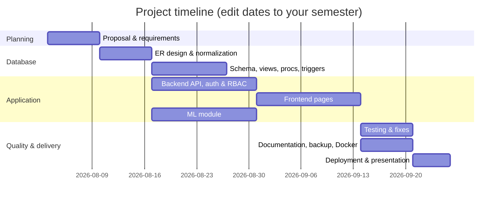

# 1–5. Project Proposal

## Project title
**Air-Gapped Predictive Copilot for Secure MPLS Operations**

## Problem statement
Network administrators and engineers must monitor complex MPLS environments involving network devices, performance telemetry, logs, alerts and incidents. Manual monitoring can delay the identification of abnormal network behaviour and increase incident response time.

## Objectives
1. Store and relate MPLS operational data (devices, telemetry, alerts, incidents, predictions, recommendations, engineer actions, outcomes, audit records) in a normalized MySQL database.
2. Detect abnormal telemetry patterns with a **local** machine-learning model and express them as an explainable risk score.
3. Map each assessment to an advisory recommendation and record the engineer's action and its outcome.
4. Enforce secure authentication and role-based access (Administrator, Network Engineer, Auditor) on every API endpoint.
5. Run fully on-premise: no external AI API and no transfer of telemetry to a cloud provider at runtime.

## Scope
**In scope:** web dashboard; device/telemetry/alert/incident management; local anomaly detection and recommendations; engineer actions and outcomes; reports with CSV/PDF export; audit logging; MySQL views, stored procedures, triggers and transactions; backup/restore scripts; Docker configuration; automated tests.

**Out of scope:** live SNMP/gNMI collection from real routers, automatic configuration push to devices, validated prediction of real MPLS hardware failures (no labelled MPLS failure dataset was available — see `ml_model_card.md`).

## Team members and responsibilities (template — fill in)
| Member | Student ID | Responsibilities | Status |
|---|---|---|---|
| [Name 1] | [ID] | Database design (ER, schema, normalization) | [ ] |
| [Name 2] | [ID] | Backend API, authentication & RBAC | [ ] |
| [Name 3] | [ID] | Frontend UI & reports | [ ] |
| [Name 4] | [ID] | ML module, testing, documentation | [ ] |

## Technology stack
| Layer | Technology | Notes |
|---|---|---|
| Frontend | React 19 (Create React App, JavaScript), React Router, Recharts, plain CSS | **Deviation:** the build environment's supervised dev server runs CRA/JavaScript, so Vite + TypeScript was not used. Pages, validation and role-based routing are equivalent. |
| Backend | Python 3.11, FastAPI, Pydantic v2 | OpenAPI at `/api/docs` |
| Database | MySQL 8 (Docker) / MariaDB 10.11 (development environment, MySQL-compatible) | Views, procedures, triggers verified on MariaDB 10.11 |
| ORM / migrations | SQLAlchemy 2, Alembic | `backend/alembic/versions/0001_baseline.py` |
| Auth | JWT (PyJWT, HS256), bcrypt (12 rounds), token revocation table | |
| ML | pandas, NumPy, scikit-learn (IsolationForest), joblib | Local inference only |
| Reports | reportlab (PDF), csv | Generated server-side |
| Testing | pytest + FastAPI TestClient (disposable MySQL test DB), Jest (frontend), Playwright E2E (run by QA agent) | |
| DevOps | Git, GitHub Actions workflow, Docker Compose | CI workflow not yet executed on GitHub |

## Major deliverables
Source code (frontend, backend, ML, database scripts, migrations, tests); ER diagrams (PNG/SVG/PDF + Mermaid); relational schema; data dictionary; 3NF analysis; database feature documentation; security and backup guides; test results; faculty compliance matrix (MD + PDF); README with run instructions.

## Project timeline (Gantt)

| Week | 1 | 2 | 3 | 4 | 5 | 6 | 7 | 8 | 9 |
|---|---|---|---|---|---|---|---|---|---|
| Proposal | ■ | | | | | | | | |
| DB design | | ■ | ■ | | | | | | |
| Backend + Auth | | | ■ | ■ | | | | | |
| Frontend | | | | | ■ | ■ | | | |
| ML | | | ■ | ■ | ■ | | | | |
| Testing & docs | | | | | | | ■ | ■ | |
| Deployment | | | | | | | | | ■ |
